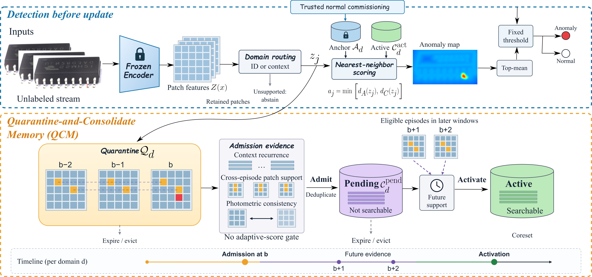

# SafeCAD

Official implementation of **SafeCAD: Contamination-Resistant Continual Adaptation for Industrial Anomaly Detection**.

SafeCAD adapts a frozen patch-memory detector to changes in normal appearance using an unlabeled, potentially contaminated stream. Our Quarantine-and-Consolidate Memory (QCM) collects cross-episode context and patch evidence before admitting prototypes to pending memory. Additional support from later windows is required before a prototype becomes searchable. Trusted commissioning anchors and operating thresholds remain fixed.



## Installation

Python 3.10 or later is required. An NVIDIA GPU is recommended for DINOv2; CPU inference is supported with `--device cpu`. Run all commands from the repository root.

### Reference environment

Our reference configuration uses Python 3.10.13, PyTorch 2.1.2, torchvision 0.16.2, and CUDA 12.1:

```bash
conda create -n safecad python=3.10.13 -y
conda activate safecad
python -m pip install -r requirements-cu121.txt
python -m pip install -e .
```

The PyTorch wheels include the CUDA runtime. A compatible NVIDIA driver is required; compiling CUDA extensions is not required. See the [PyTorch installation guide](https://pytorch.org/get-started/locally/) for other CUDA versions.

### Current PyTorch environment

```bash
python -m venv .venv
source .venv/bin/activate
python -m pip install --upgrade pip
python -m pip install -e ".[all]"
```

On Windows, activate the environment with `.venv\Scripts\Activate.ps1` in PowerShell. For a CPU-only installation:

```bash
python -m pip install torch torchvision --index-url https://download.pytorch.org/whl/cpu
python -m pip install -e ".[data,eval,test]"
```

### Pretrained encoders

The default encoder is the non-register [DINOv2 ViT-B/14](https://github.com/facebookresearch/dinov2). SafeCAD extracts transformer blocks 8 and 12 with the pretrained output LayerNorm, normalizes each block, and concatenates the patch features into 1,536 channels. Input images are resized with preserved aspect ratio and padded to 448 × 448.

Weights download automatically on first use. For offline execution, download the [ViT-B/14 checkpoint](https://dl.fbaipublicfiles.com/dinov2/dinov2_vitb14/dinov2_vitb14_pretrain.pth) to `pretrained/dinov2_vitb14_pretrain.pth` and clone the encoder repository:

```bash
git clone https://github.com/facebookresearch/dinov2.git third_party/dinov2
```

Append these options to both training and testing:

```bash
--dino-repository third_party/dinov2 --weights pretrained/dinov2_vitb14_pretrain.pth
```

Compact SafeCAD uses ImageNet-pretrained MobileNetV3-Small, 256 × 256 inputs, and 72-dimensional features. Select it with `--encoder compact` during both training and testing. Its pretrained weights also download automatically.

## Datasets

| Dataset | Download | Local directory |
| --- | --- | --- |
| Real-IAD | [Dataset](https://huggingface.co/datasets/Real-IAD/Real-IAD), [project page](https://realiad4ad.github.io/Real-IAD/) | `data/Real-IAD/` |
| CoalConveyor-AD | Available on request | `data/CoalConveyor-AD/` |

Real-IAD access requires accepting its conditions on Hugging Face. Dataset files, pretrained weights, generated manifests, and run outputs are excluded from version control. Dataset licenses are independent of the source-code license.

## Real-IAD

### 1. Download and extract

Request access on the [dataset page](https://huggingface.co/datasets/Real-IAD/Real-IAD), then authenticate and download:

```bash
hf auth login
python -m safecad.data download-realiad --root data/Real-IAD
```

The command downloads the 1024-resolution category ZIP archives and `realiad_jsons.zip`, then extracts them. To download one category first:

```bash
python -m safecad.data download-realiad --root data/Real-IAD --categories audiojack
```

For manual downloading, obtain the same archives from Hugging Face and use the [official directory layout](https://github.com/Tencent/AnomalyDetection_Real-IAD#11-download-the-decompress-the-dataset):

```text
data/Real-IAD/
├── realiad_1024/
│   ├── audiojack/
│   │   ├── OK/...
│   │   └── NG/...
│   └── ...
├── realiad_jsons/
│   ├── audiojack.json
│   └── ...
└── realiad_jsons_sv/...
```

Metadata nested under `realiad_jsons/realiad_jsons/` is also supported. Pass `--metadata-dir PATH` during preparation to select it explicitly.

### 2. Prepare the continual protocol

```bash
python -m safecad.data prepare-realiad --root data/Real-IAD --output data/protocols/realiad/seed_0/rho_005 --seed 0 --contamination 0.05
```

The primary protocol uses camera C1 and 24 target categories. After lexicographic sorting, category positions 2, 7, 12, 17, 22, and 27 are reserved for source development. Each category supplies:

| Split | Observations |
| --- | --- |
| Trusted initialization | 16 normal physical samples |
| Threshold calibration | 20 disjoint normal physical samples |
| Unlabeled adaptation | 256 physical samples |
| Held-out evaluation | 128 normal and 64 defective physical samples |

Nominal contamination levels `0`, `0.01`, `0.05`, `0.10`, and `0.20` give 0, 3, 13, 26, and 51 defective adaptation samples. Commissioning and evaluation cohorts stay identical across contamination levels for a fixed seed. Physical samples are disjoint across splits; defective samples require a nonempty mask in the selected view.

Preparation writes:

```text
data/protocols/realiad/seed_0/rho_005/
├── commission.json
├── adaptation.json
├── adaptation_labels.json
├── evaluation.json
└── protocol.json
```

`adaptation.json` contains acquisition information only. Labels and masks are stored separately in `adaptation_labels.json` for retrospective analysis and are never passed to QCM.

Use `--categories audiojack` for a single-category run, `--partition source` for source development, or `--partition all` for all categories. Partitioning uses the complete metadata directory even when only selected image archives have been downloaded.

### 3. Train

Training consists of trusted commissioning followed by QCM adaptation. The encoder stays frozen, so training does not require an optimizer or gradient-based fine-tuning.

```bash
python -m safecad train --commission-manifest data/protocols/realiad/seed_0/rho_005/commission.json --adapt-manifest data/protocols/realiad/seed_0/rho_005/adaptation.json --output runs/realiad/seed_0/rho_005/train --device cuda
```

The command builds anchors, calibrates fixed thresholds, processes the unlabeled stream in acquisition order, and saves `model.safecad`. Every observation is scored before updating memory. Omit `--adapt-manifest` to train the frozen-anchor detector.

### 4. Test

```bash
python -m safecad test --manifest data/protocols/realiad/seed_0/rho_005/evaluation.json --checkpoint runs/realiad/seed_0/rho_005/train/model.safecad --output runs/realiad/seed_0/rho_005/test --device cuda --aupro
```

Testing freezes the checkpoint by default. The evaluator reports image AUROC/AP, pixel AUROC/AP, AUPRO up to FPR 0.30, fixed-threshold recall/FPR, recall loss, FPR reduction, and coverage. It writes per-category results and category-macro averages to `metrics.json`. AUPRO is enabled by `--aupro`; undefined metrics are stored as `null`.

Pixel metrics use original image coordinates. For lower memory use, add `--metric-max-side 256` to resize maps and masks for evaluation; keep this setting consistent across compared runs. Use `--image-only` to skip pixel maps and segmentation metrics.

To evaluate the commissioned anchor baseline, replace the checkpoint with `runs/realiad/seed_0/rho_005/train/initial.safecad`.

### 5. Run all seeds and contamination levels

```bash
python -m safecad.experiments --root data/Real-IAD --output runs/realiad_full --seeds 0 1 2 3 4 --contamination 0 0.01 0.05 0.10 0.20 --device cuda --aupro
```

The runner prepares data, trains, tests, and writes `summary.json`. Seeds are averaged within each category before averaging categories. Runs with an existing `test/metrics.json` are skipped when resuming. Use a new output directory when changing settings.

For a compact single-category experiment:

```bash
python -m safecad.experiments --root data/Real-IAD --output runs/compact_audiojack --categories audiojack --seeds 0 --contamination 0.05 --encoder compact --device cpu --metric-max-side 256
```

## CoalConveyor-AD

CoalConveyor-AD is available on request. Please contact the authors to obtain access.

Place frames, masks, and an acquisition index under:

```text
data/CoalConveyor-AD/
├── frames/
│   ├── C1/session_001/...
│   └── ...
├── masks/...
└── index.csv
```

The index has one row per frame. Paths are relative to `index.csv`; timestamps are acquisition times in seconds on a common time axis within each camera:

```csv
image,domain,session,timestamp,split,label,mask,event_id
frames/C1/session_001/000001.jpg,C1,session_001,0,initialization,0,,
frames/C1/session_002/000001.jpg,C1,session_002,3600,calibration,0,,
frames/C1/session_003/000001.jpg,C1,session_003,7200,adaptation,,,
frames/C1/session_004/000001.jpg,C1,session_004,10800,evaluation,1,masks/C1/event_001/000001.png,event_001
```

The supported split values are `initialization`, `calibration`, `adaptation`, and `evaluation`. Provide 16 verified normal initialization frames and at least 20 disjoint normal calibration frames per camera. Calibration frames must be at least 60 seconds apart. Reviewed labels are `0` for normal and `1` for anomalous; leave labels empty for unreviewed frames. Defective-frame masks enable pixel metrics. Whole sessions and events stay within one acquisition split; initialization and calibration both belong to the commissioning period.

To extract video frames, install [FFmpeg](https://ffmpeg.org/download.html), create the destination directory, and run:

```bash
ffmpeg -i camera_session.mp4 -vf fps=5 -start_number 0 data/CoalConveyor-AD/frames/C1/session_001/%08d.jpg
```

Index timestamps are the session start time plus the frame index divided by five. Retain reviewed interval labels and pixel-mask paths when constructing the index.

### Prepare and train

```bash
python -m safecad.data prepare-coal --index data/CoalConveyor-AD/index.csv --output data/protocols/coal --episode-seconds 10
python -m safecad train --commission-manifest data/protocols/coal/commission.json --adapt-manifest data/protocols/coal/adaptation.json --config configs/bulk.json --output runs/coal/train --device cuda
```

Use `--camera C1` during preparation to select one camera. Frames are grouped into ten-second acquisition episodes in chronological order within each camera. Only the first frame of each episode is retained for adaptation; every frame is scored. Four completed episodes form a window. The bulk-material configuration permits matching across the inspection grid.

### Frozen-checkpoint evaluation

```bash
python -m safecad test --manifest data/protocols/coal/evaluation.json --checkpoint runs/coal/train/model.safecad --output runs/coal/checkpoint --device cuda --aupro
```

### Online evaluation

```bash
python -m safecad test --manifest data/protocols/coal/evaluation.json --checkpoint runs/coal/train/model.safecad --output runs/coal/online --device cuda --online --aupro
```

Both runs start from the same adapted checkpoint. The online run scores before updating and writes its final state to `final.safecad`. Reviewed frame metrics and pixel metrics are computed retrospectively.

## Custom datasets

Use the same `train` and `test` commands with custom JSON manifests. Image and mask paths are relative to the corresponding manifest.

**Commissioning manifest:**

```json
{
  "domains": [
    {
      "id": "camera_1",
      "initialization": ["normal/init_001.png", "normal/init_002.png"],
      "calibration": ["normal/cal_001.png", "normal/cal_002.png"]
    }
  ]
}
```

Expand the lists with verified normal observations, including at least 20 calibration images. Initialization and calibration observations must be disjoint.

**Adaptation manifest:**

```json
[
  {"image": "stream/000001.png", "episode": 0, "domain": "camera_1"},
  {"image": "stream/000002.png", "episode": 0, "domain": "camera_1"},
  {"image": "stream/000003.png", "episode": 1, "domain": "camera_1"}
]
```

Episode IDs are nonnegative integers and increase between episodes. Frames of one episode must be contiguous. Repeated views of the same physical item share an episode. Each listed episode is complete at its final row; an incomplete trailing window does not trigger consolidation.

**Evaluation manifest:**

```json
[
  {"image": "test/normal.png", "episode": 1000, "domain": "camera_1", "label": 0},
  {"image": "test/defect.png", "episode": 1001, "domain": "camera_1", "label": 1, "mask": "masks/defect.png"}
]
```

Labels are used only by the retrospective evaluator. Normal observations without a mask use an all-zero mask. Defective observations without a mask contribute to image metrics only.

### Task-free routing

Add `--task-free` to training, streaming, or testing to ignore supplied domain IDs. Routing is fixed by the first observation of each episode. Unsupported contexts abstain and return no calibrated binary decision. Ranking metrics use covered observations; fixed-threshold recall includes abstentions as misses, and coverage is reported separately. New domains require trusted commissioning.

### Inference without evaluation labels

```bash
python -m safecad stream --manifest data/custom/stream.json --checkpoint runs/custom/train/model.safecad --output runs/custom/predictions --device cuda --frozen --maps
```

Remove `--frozen` to enable adaptation. For application integration, use `SafeCAD`, `Features`, `FrozenEncoder`, and `ImageProcessor` from the Python package.

## Configuration

Pass `--config PATH` during training or commissioning to override Config fields using a JSON object. `configs/default.json` contains the DINOv2 settings. `configs/bulk.json` permits full-grid spatial matching. Compact radii are selected automatically by `--encoder compact`.

| Component | Default |
| --- | --- |
| Anchors / pending / active prototypes | 1,024 / 256 / 768 per domain |
| Quarantine / unsupported observations | 64 / 64 |
| Retained patches | 8 × 8 fixed spatial layout |
| Retained observations per episode | 1 |
| Episodes per window | 4 |
| Context / patch / future episode support | 3 / 3 / 3 |
| Context / patch / future window support | 2 / 2 / 2 |
| Quarantine / pending lifetime | 8 / 8 windows |
| Context / patch / duplicate radius | 0.20 / 0.15 / 0.05 |
| Spatial radius | 0.10 for registered views |
| Routing radius / context update rate | 0.35 / 0.05 |
| Photometric views | Brightness and contrast at 0.95 and 1.05 |
| Context / patch consistency threshold | 0.95 / 0.95 |
| Image score | Mean of the largest 1% of patch scores |
| Calibration | Fixed empirical 0.95 quantile |

Pending prototypes never participate in inference. Admission uses quarantine context, patch recurrence, and view consistency. Only anchors and active prototypes are searched. Nearest-neighbor scoring is spatially unrestricted; coordinates constrain admission and duplicate suppression.

## Outputs

```text
runs/experiment/
├── train/
│   ├── initial.safecad
│   ├── model.safecad
│   ├── train_config.json
│   └── adaptation/
│       ├── predictions.jsonl
│       ├── events.jsonl
│       └── final.safecad
└── test/
    ├── predictions.jsonl
    ├── events.jsonl
    ├── metrics.json
    └── map_00000000.npy
```

Checkpoints store anchors, fixed thresholds, routing contexts, pending/active prototypes, bounded quarantine evidence, and acquisition counters. Encoder weights are loaded separately. Use the same encoder and weight file throughout a run; local weight files are checked by SHA-256. Anomaly maps are float32 arrays in original image coordinates. Lifecycle events retain origin indices for external provenance analysis.

## Development

```bash
python -m pytest -q
python -m examples.synthetic
python -m safecad --help
python -m safecad.data --help
```

Tests cover commissioning, score-before-update ordering, support counts, delayed activation, memory budgets, routing, checkpoint continuation, image geometry, data preparation, and evaluation.

```text
assets/              Overview figure
configs/             Memory and matching configurations
examples/            Feature-level usage
safecad/
  core.py            Quarantine-and-Consolidate Memory
  vision.py          Frozen encoders and image geometry
  features.py        Pooling, exact search, and coresets
  data.py            Dataset download and preparation
  cli.py             Training, streaming, and testing
  evaluation.py      Image and pixel metrics
  experiments.py     Multi-seed experiment runner
  checkpoint.py      Detector-state persistence
tests/               Automated tests
```

## Acknowledgments

We thank the authors of [DINOv2](https://github.com/facebookresearch/dinov2), [torchvision](https://github.com/pytorch/vision), and [Real-IAD](https://github.com/Tencent/AnomalyDetection_Real-IAD) for making their code and data available.

## License

SafeCAD source code is released under the [MIT License](LICENSE). Pretrained encoders and datasets retain their respective licenses.
